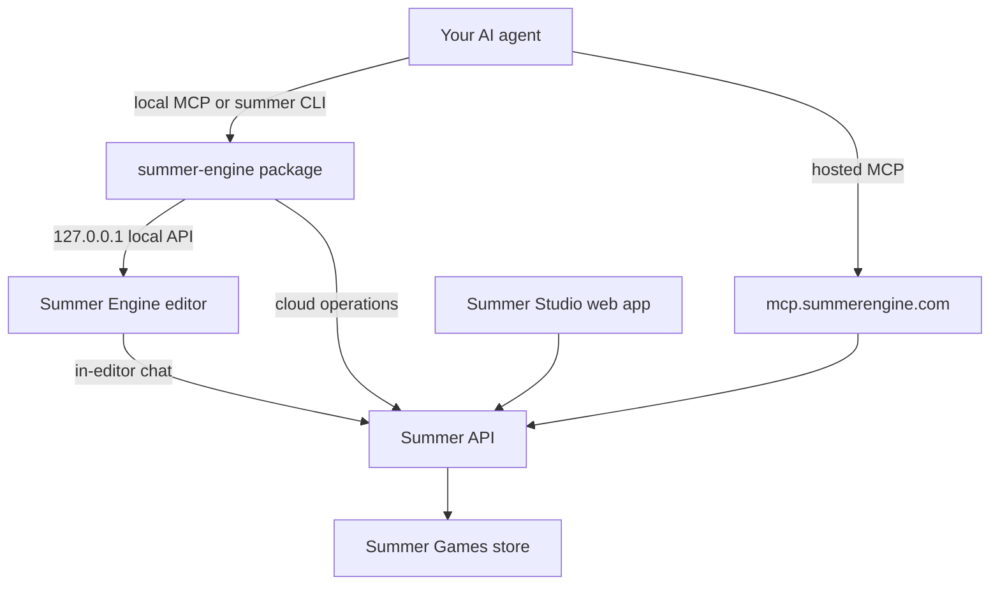

Summer Engine is the game engine built for AI. It has a few parts that work together: a desktop
editor on your computer, a local API inside that editor, the `summer-engine` npm package for AI
agents, a hosted MCP server, and Summer Studio on the web.

## The desktop editor

Summer Engine is a fork of Godot 4. Projects use the normal Godot project format, and you write
game code in GDScript or C#. The app bundles its own .NET SDK, so C# needs no separate install.
Summer adds its own modules to the editor:

- **The chat panel.** The in-editor AI chat, shown in an embedded web view.
- **The local API server.** A server on `127.0.0.1` that lets the `summer-engine` package read and
  edit the open project. Each request needs a token.
- **Sign-in and telemetry.** The editor signs in with your Summer account and sends product
  analytics events.

These classes are editor-only. A game you export does not contain them. See
[GDExtension](/extending/gdextension) for the list.

### How agents find a running editor

The interactive editor writes its port to `~/.summer/api-port` and its token to
`~/.summer/api-token`. Each running editor also registers itself under `~/.summer/instances/`, keyed
by project, so a client can pick the right one when several projects are open. Headless, import and
export runs do not take over the global pointer. See
[Headless Scripting](/automation/headless#what-does-not-work).

## The summer-engine package

The `summer-engine` npm package holds three things:

| Part | What it does |
|---|---|
| MCP server (`summer mcp`) | Drives the running editor: build scenes, write scripts, play the game, take screenshots, read errors. After `summer login` it also runs the cloud operations. |
| CLI (`summer`) | Installs the engine, signs you in, sets up your agent, creates projects and publishes games. |
| Skills | Game-dev guides your agent loads. |

Install it with `brew install summerengine/tap/summer` or `npm install -g summer-engine`, then run
`npx -y summer-engine@latest setup <agent> --yes`. See [MCP setup](/mcp/setup) and the
[CLI reference](/mcp/cli-reference).

## The hosted MCP server

`https://mcp.summerengine.com/mcp` runs the cloud operations with nothing to install: assets,
plans, the store, publishing, prices and analytics. It has no engine tools. For engine work, use
the local server. See [Summer MCPs](/mcp/summer-mcps).

## Summer Studio and Summer Games

[Summer Studio](https://www.summerengine.com/studio) is the web app for your account, credits,
asset generation, store pages and publishing. Published games go to the
[Summer Games](https://summer.games) store, where players find and play them.

## Extending the editor

Summer keeps Godot's extension points:

- [Editor plugins](/extending/editor-plugins): custom panels, inspectors and tools
- [GDExtension](/extending/gdextension): native code loaded at runtime
- [Engine modules](/extending/modules): C++ compiled into the engine

Many Godot plugins load in Summer, but test each one on a committed copy of your
project first. See [Godot compatibility](/knowledge-base/godot-compatibility).

## Security and privacy

See the [Security overview](/security/overview) for how Summer handles your data, and
[Privacy Mode](/security/privacy-mode) for model training controls.

## Requirements and plans

- System requirements: [Installation](/essentials/installation#system-requirements)
- Plans and usage limits: [Pricing](/essentials/pricing)
